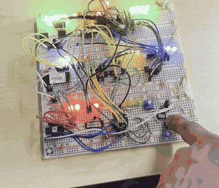
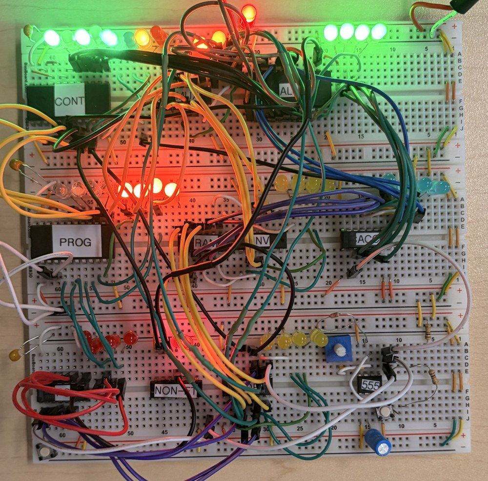

# 4-Bit Breadboard Computer

A working **4-bit computer** built from scratch on breadboards with logic chips and a lot of jumper wires.
It runs a small program stored in its program memory: a **countdown from 15 to 0**, followed by **all the lights flashing**.

*The four blue LEDs show the countdown. ([Full-quality video](media/demo.mp4))*

## The hardware

The main blocks are labeled on the board:

| Label | Block |
|---|---|
| **CONT** | Control unit |
| **PROG** | Program memory |
| **RAM** | Data memory |
| **ALU** | Arithmetic logic unit (add / subtract) |
| **ACC** | Accumulator register |
| **INV**, **NON-ET** | Inverter and NAND logic gates |
| **555** | Clock, built around a 555 timer |

The rows of LEDs show what is happening inside the machine at every step, and the blue LEDs are the output.

## The program

Each instruction works with the accumulator (A) and the RAM. Line numbers start at 0, and jumps use these numbers.

| Line | Instruction | What it does |
|---|---|---|
| 0 | `Load 15` | A = 15 |
| 1 | `Store 0` | Save A in memory[0] (the counter) |
| 2 | `Read 0` | Select memory[0] |
| 3 | `Load mem` | A = memory[0] |
| 4 | `Sub 1` | A = A − 1 |
| 5 | `Jzero 8` | If A is 0, jump to the flash (line 8) |
| 6 | `Store 0` | Save the new count |
| 7 | `Jump 2` | Repeat |
| 8 | `Load 15` | All lights on (1111) |
| 9 | `Load 0` | All lights off (0000) |
| 10 | `Jump 8` | Flash forever |

The same program with comments is in [`program.txt`](program.txt).

**Instructions used:** `Load` (a number or `mem`), `Store`, `Read`, `Add`, `Sub`, `Jump`, `Jzero` (jump if the result is zero).
