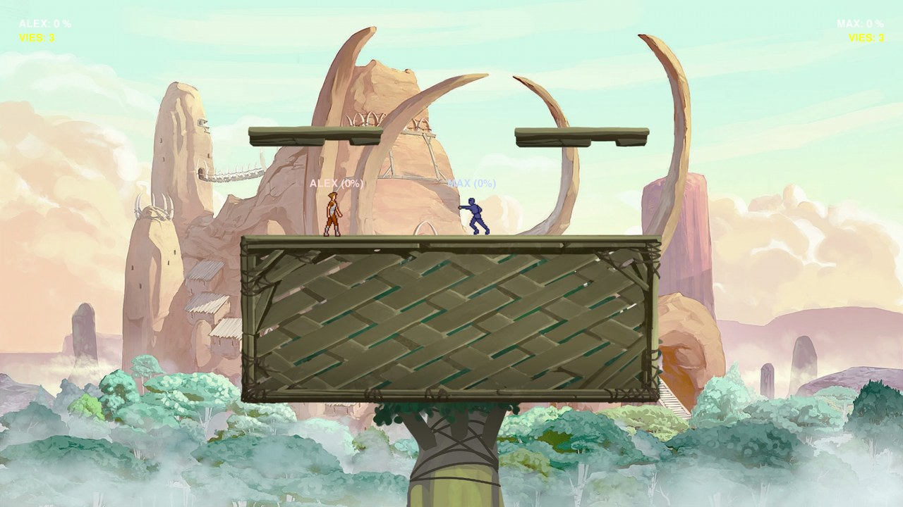
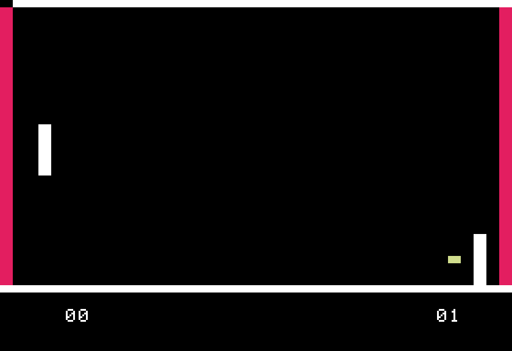

# Alex Gaudreau — Projects

Computer Engineering student at McGill University. This repository collects some of the projects I've worked on.

| Project | Description | Tech |
|---|---|---|
| [**Super Battle**](super-battle/) | 2-player platform fighting game in the style of *Super Smash Bros.*, built for a homemade arcade cabinet and playable on PC | Python, Pygame, SQLite |
| [**Ping Pong — Apple II**](ping-pong-apple2/) | *Pong*-style game with a computer opponent, written in 6502 assembly for the Apple II | 6502 Assembly, Apple II |

| Super Battle | Ping Pong — Apple II |
|:---:|:---:|
|  |  |
