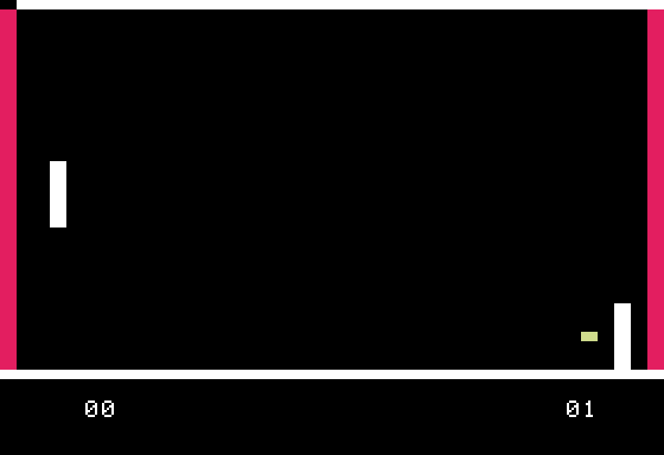
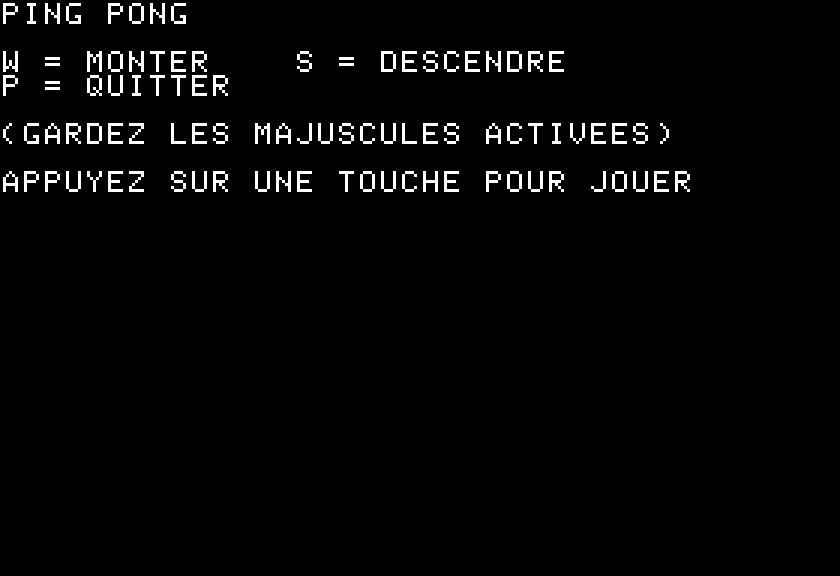

# Ping Pong — Apple II (6502 Assembly)

A *Pong*-style game for the **Apple II**, written in **6502 assembly language** with the Merlin assembler.
You control the left paddle against a computer-controlled paddle on the right.

## Play it

1. Download [`PingPong.dsk`](PingPong.dsk) and the [AppleWin](https://github.com/AppleWin/AppleWin) emulator (Windows).
2. In AppleWin, put `PingPong.dsk` in **Drive 1** (or drag it onto the window) and start/reboot the machine.
3. The disk boots, shows the controls, and starts the game when you press a key.

| Key | Action |
|---|---|
| **W** | Move up |
| **S** | Move down |
| **P** | Quit |

> Keep **Caps Lock** on: the game reads the uppercase W and S keys.

## How it works

- **Pure 6502 assembly** (~720 bytes of machine code), loaded at `$8000`
- **Lo-res graphics** (40×40, 16 colors) drawn with the Apple II Monitor ROM routines (`PLOT`, `HLINE`, `VLINE`, `SETCOL`)
- **Collision detection by reading the screen**: before moving the ball, the game asks the ROM (`SCRN`) what color is at the next position, so walls, paddles and goals are detected by their color
- **Keyboard read straight from the hardware** registers (`$C000` / `$C010`)
- **Computer opponent** with two modes: it patrols up and down while the ball is far, then tracks the ball's height once the ball crosses the middle of the court
- **Score** for both sides, shown at the bottom of the screen

## Source code and versions

The [`src/`](src) folder contains every version I saved while building the game, so you can follow how it grew:

| File | Step |
|---|---|
| `PINGPONG.s` | Court frame and the main loop: draw, erase and move the ball |
| `PINGPONG2.s` | Bounces off walls (collision by screen color) and goal detection |
| `PINGPONG3.s` | Player paddle controlled with W / S |
| `PINGPONG4.s` | Pause after each point and cleanup |
| `PINGPONG5.s` | First computer opponent (patrol + tracking the ball) |
| `PINGPONG6.s` | Opponent kept inside the court |
| `TESTAIPING.s` | Reworked opponent logic — **this is the version on the disk** |

The `.dsk` also contains these source files (as `*.S`), so they can be opened in Merlin.

## Built with

- 6502 assembly, Merlin assembler
- Apple II DOS 3.3
- AppleWin emulator
