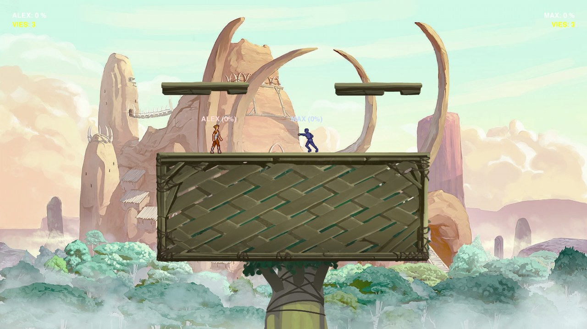
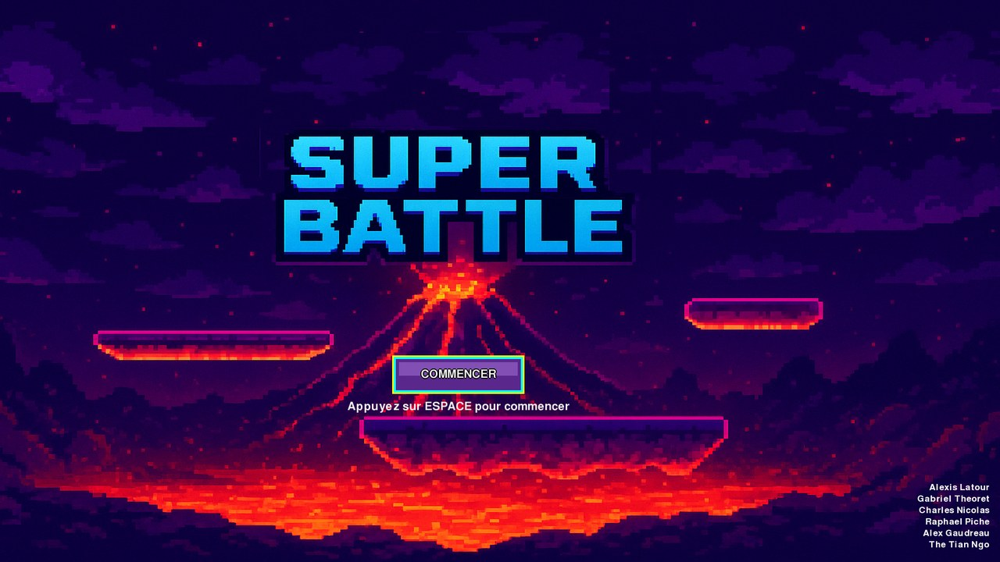
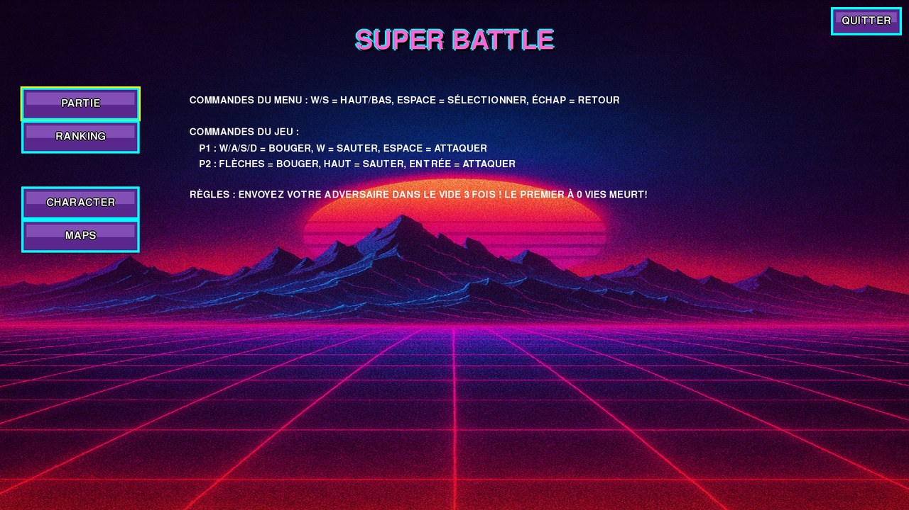
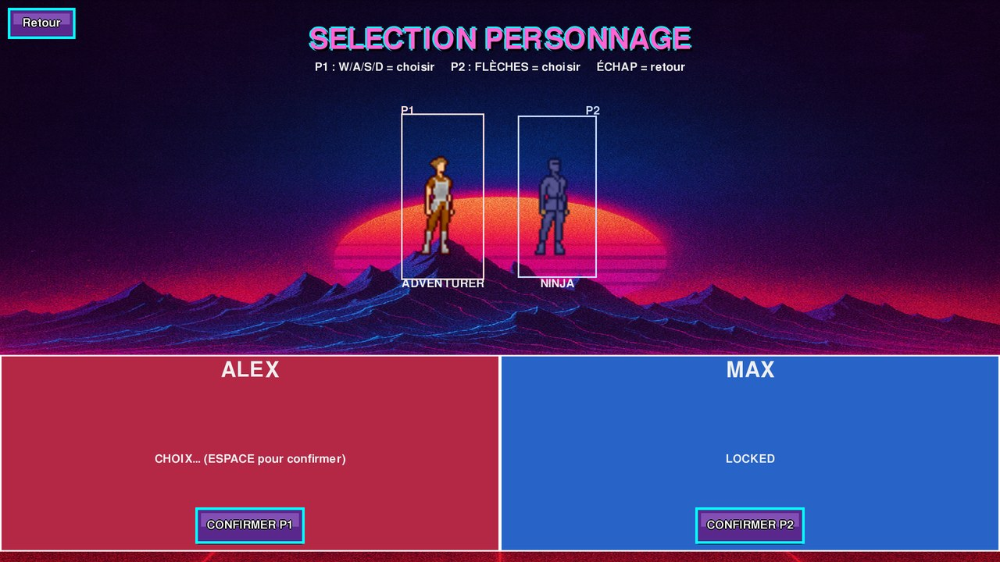

# Super Battle

A 2-player platform fighting game in the style of *Super Smash Bros.*, written in **Python** with **Pygame**.
It was originally built for a homemade **arcade cabinet** (Raspberry Pi running RetroPie, two joysticks) and now also runs on any PC with the keyboard.



## Features

- **Local 1 vs 1** on the same machine, or **1 vs the computer**
- **Smash-style combat**: every hit raises the opponent's damage %, and the higher it is, the farther they fly. Knock your opponent off the stage 3 times to win
- **Platforming physics**: gravity, double jump, fast fall and wall slide, with collisions on every platform
- **Computer opponent** that chases, attacks when in range and tries to recover when it falls off the stage
- **2 characters** animated from sprite sheets, and **3 maps**, with a solo *play test* mode to try each map
- **Player login** with an on-screen keyboard (the cabinet has no keyboard) and a country flag
- **Leaderboard** of wins (top 10) saved in a local **SQLite** database
- **Arcade or PC input**: a small input layer lets the keyboard imitate the cabinet's joysticks, so the same code runs on both, and every screen shows the right buttons for the controls being used

| Title screen | Main menu | Character select |
|:---:|:---:|:---:|
|  |  |  |

## How to run

1. Install [Python 3](https://www.python.org/downloads/)
2. Install the game's library:
   ```
   pip install -r requirements.txt
   ```
   (In Thonny: *Tools → Manage packages*, search for `pygame-ce`, then *Install*.)
3. Start the game:
   ```
   python super_battle.py
   ```

The game opens in fullscreen. Use the **QUITTER** button in the main menu (or Alt+F4) to quit.

> The in-game text is in French.

## Controls

| Action | Player 1 | Player 2 | Arcade cabinet |
|---|---|---|---|
| Move | W / A / S / D | Arrow keys | Joystick |
| Jump | W | Up arrow | Button A |
| Attack / confirm | Space | Enter | Button C |
| Back | Esc | | Button D |
| Change country (login) | Q / E | , / . | Buttons A / B |

## Built with

- Python 3
- [pygame-ce](https://pyga.me/) (graphics, input, sound)
- SQLite (`sqlite3`) for players and the leaderboard

## Project structure

```
super-battle/
├── super_battle.py   # The whole game: menus, login, gameplay, AI, leaderboard
├── AB/               # Sprites, maps, flags, music
├── screenshots/      # Images used in this README
└── requirements.txt
```

## Team

Made as a team of six:
Alex Gaudreau, Gabriel Théoret, Alexis Latour, Raphaël Piché, Charles Nicolas and Thé Tian Ngo.
